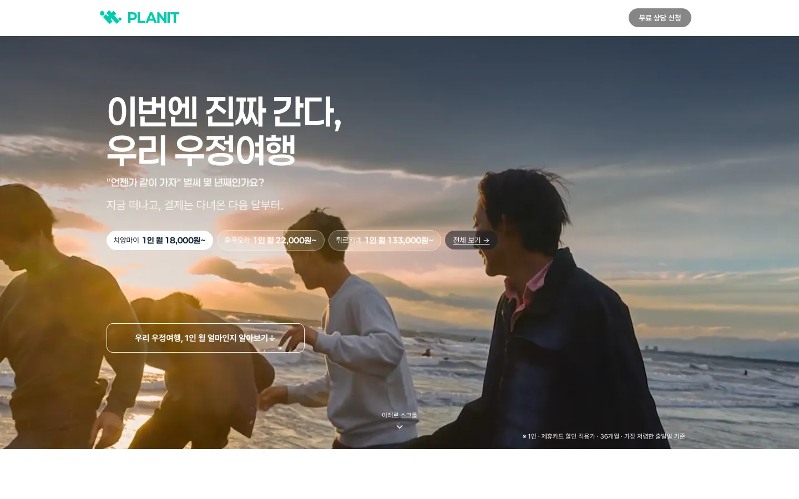
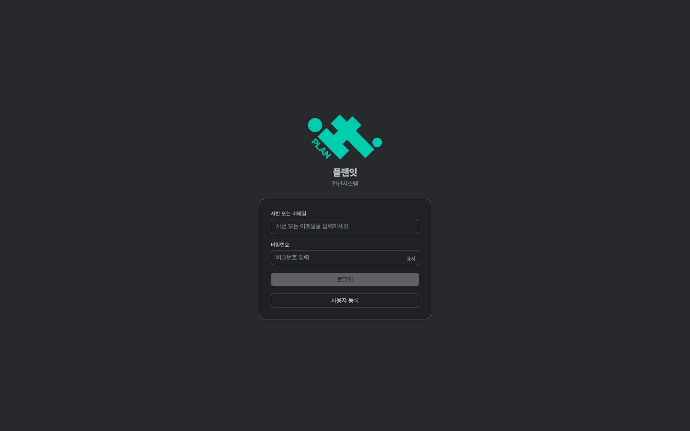
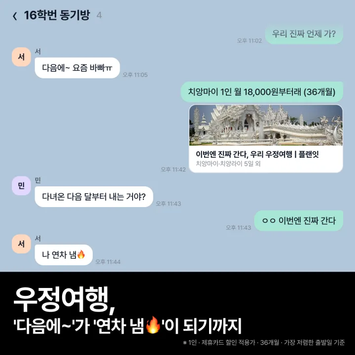
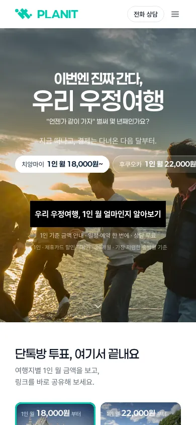

# 임현택 · 풀스택 개발자

TnG 의 사내 보험 전산과 대외 사이트 플랜잇을 설계·구현·배포·운영하고, 피그마 시안 코드화와 메타 광고 운영까지 맡고 있습니다.

## 한눈에 보기

| 항목 | 내용 |
|---|---|
| 기간 | 2026-08-05 ~ 2026-10-23 (약 11주) |
| 저장소 | 4개 — Planit, Insurance_backend, Insurance_frontend, Insurance_infra |
| 커밋 | 1,867 / 2,453 (세 저장소 합계의 76%) |
| PR | 648 / 713 |
| 자동 테스트 | 약 6,900건 (JUnit 4,475 · 프런트 1,475 · vitest 932) |
| 운영 승격 | dev → 운영 10차 |

저장소마다 공동 작업자 1명과 함께 작업했습니다. 업무 저장소는 비공개라 코드 대신 구조와 결정을 정리했습니다.

## 프로젝트

### 1. 플랜잇 — 대외 상담 사이트

후불 여행·보험·휴대폰·렌탈 상담을 받는 사이트([플랜잇.com](https://플랜잇.com)).
Next.js 15 정적 내보내기를 S3 + CloudFront 로 배포합니다.
피그마 시안을 웹·모바일 두 벌로 옮긴 여행 랜딩 시리즈, 상담 접수 폼, 픽셀·분석 계측을 구현했습니다.

[상세 보기 →](projects/planit.md)

### 2. TnG INSURE — 사내 보험 전산

Spring Boot 3.5 백엔드와 React 19 웹 어드민. 5개 업종의 고객·상담 케이스, 계약 원장·매출·수수료, 역할별 권한, 캘린더·근태, 메신저를 다룹니다.
사이트 접수를 고객·케이스로 자동 생성하고 미배정 건을 알립니다. 운영은 ECS 입니다.

[상세 보기 →](projects/insurance-system.md)

### 3. 메타 광고 운영

메타 공식 Ads MCP 로 캠페인·광고 세트·소재·광고를 코드로 생성·조정합니다.
픽셀 Lead 전환으로 최적화하고, 동적 UTM 으로 전산에서 광고·노출 위치 단위까지 유입을 추적합니다.

[상세 보기 →](projects/meta-ads.md)

## 기술 스택

| 구분 | 기술 |
|---|---|
| 백엔드 | Java 17, Spring Boot 3.5, PostgreSQL, Redis, Flyway, JWT |
| 프런트엔드 | TypeScript, React 19, Next.js 15, vinext(Vite 8), Tailwind CSS 4, Tiptap, three.js |
| 인프라 | AWS ECS·ECR·EC2·S3·CloudFront, CloudFormation, Terraform, Docker Compose, Caddy, GitHub Actions |
| 도구 | JUnit, vitest, 헤드리스 Chrome, Figma MCP, Meta Ads MCP, Claude Code |

## 일하는 방식

- **피그마 → 코드**: 피그마 MCP 로 시안을 읽어 웹 1440·모바일 390 두 벌로 구현하고, 헤드리스 Chrome 캡처를 시안과 픽셀 단위로 비교합니다.
- **dev → 운영 승격**: `promote/<날짜>` 브랜치를 만들고, 아직 올리지 않을 기능은 제외 집합으로 묶어 빼고 승격합니다.
- **테스트·검증**: 전산은 CI 테스트 뒤에 배포하고 운영 배포 후 헬스체크로 확인합니다. 화면은 헤드리스 Chrome 캡처로 시안과 대조합니다.
- **AI 도구 활용**: Claude Code 로 작업을 서브에이전트에 나눠 맡기고, PR 리뷰와 배포 검증까지 개발 흐름에 넣었습니다.

같은 랜딩의 모바일 390 첫 화면입니다.

## 연락

GitHub [@limHyeonTaek](https://github.com/limHyeonTaek)
