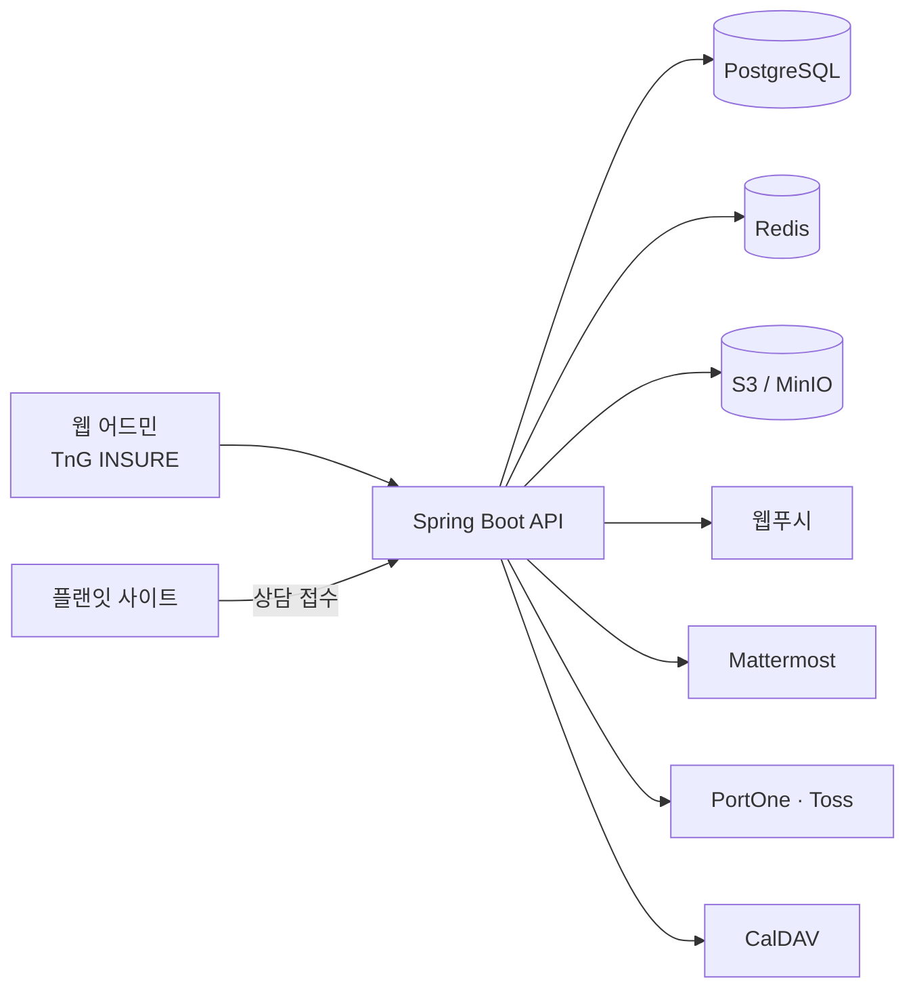

# TnG INSURE — 사내 보험 전산

[← 포트폴리오 홈](../README.md)

> 회사 업무 저장소는 비공개입니다. 코드 대신 구조와 결정만 설명합니다.

## 개요

보험·휴대폰·인터넷·렌탈·여행 5개 업종의 고객과 상담을 한곳에서 관리하는 사내 전산입니다.
Spring Boot 백엔드가 전산 API 와 대외 사이트 플랜잇의 API 를 함께 제공하고, React 웹 어드민 「TnG INSURE」가 사내 화면을 맡습니다.

| 저장소 | 시작 | 내용 | 커밋(담당/전체) | 테스트 |
|---|---|---|---|---|
| Insurance_backend | 2026-08-05 | Spring Boot API 서버 | 754 / 971 (78%) | JUnit 4,475건 |
| Insurance_frontend | 2026-08-10 | 웹 어드민 「TnG INSURE」 | 763 / 891 (86%) | 1,475건 |
| Insurance_infra | — | Terraform 설계 초안 18개 파일 | — | — |

- 백엔드: Java 약 25만 줄(이 중 절반이 테스트), Flyway 마이그레이션 90개
- 프런트엔드: TypeScript 약 5.4만 줄

## 역할

- 도메인 설계와 API 구현, DB 스키마·마이그레이션 관리
- 웹 어드민 화면 구현, 피그마 시안 적용, 모바일·다크모드 대응
- CI/CD 구성과 dev·운영 배포, dev → 운영 승격 관리
- 플랜잇 사이트 접수를 전산 업무로 잇는 동기화와 알림

## 스택

| 구분 | 기술 |
|---|---|
| 백엔드 | Java 17, Spring Boot 3.5, PostgreSQL, Redis, Flyway, JWT |
| 프런트엔드 | React 19, vinext(Vite 8 SSR), Tailwind CSS 4, Tiptap, TypeScript |
| 저장소·연동 | S3/MinIO, 웹푸시, CalDAV, PortOne·Toss 결제, Mattermost(자체 운영) |
| 배포 | GitHub Actions, Docker Compose + Caddy(dev EC2), ECR → ECS(운영) |
| 인프라 설계 | Terraform(VPC·ALB·RDS 초안) |

## 구조



배포 흐름

```text
ci.yml (테스트)
        ├─▶ deploy-dev.yml  ─▶ EC2 · docker compose + Caddy          (dev)
        └─▶ deploy-prod.yml ─▶ ECR 이미지 ─▶ ECS 배포 ─▶ 헬스체크   (운영)
```

## 핵심 기능

### 백엔드 도메인

| 영역 | 내용 |
|---|---|
| 인증·조직 | JWT 인증, 조직, 역할별 권한 |
| 고객·상담 | 고객, 상담 케이스(보험·휴대폰·인터넷·렌탈·여행 5개 업종) |
| 계약·정산 | 보험계약 원장, 매출, 수수료, 대시보드 |
| 소통 | 공지, 알림, 녹취, 메신저 |
| 일정·근태 | 캘린더(CalDAV), 근태 |
| 결제·포인트 | 포인트, PortOne·Toss 결제 |
| 단가 | 휴대폰·렌탈 단가표 |
| 사이트 연동 | 사이트 접수 → 고객·케이스 자동 생성, 유입 매체 분류, 미배정 알림 |

### 웹 어드민 화면

- RSA 암호화·2단계 로그인
- 고객·상담 케이스 관리
- 보험계약 엑셀 임포트
- 매출·수수료 화면
- 역할별 권한
- 캘린더, 근태
- 모바일 대응, 다크모드
- 피그마 시안 적용

## 기술적으로 고민한 점

### 1. 제외 집합으로 관리하는 dev → 운영 승격
dev 에는 기능이 계속 쌓이지만, 모든 기능이 같은 시점에 운영에 올라가지는 않습니다.
승격할 때마다 `promote/<날짜>` 브랜치를 만들고, 아직 운영에 올리지 않을 기능의 파일을 **제외 집합**(백엔드 146개·프런트엔드 54개 파일)으로 묶어 빼고 올립니다.
운영에 올릴 범위를 승격 시점에 고를 수 있고, 이 방식으로 10차 승격까지 진행했습니다.

### 2. 사이트 접수를 전산 업무로 바꾸는 동기화
플랜잇 사이트의 접수(`site_inquiry`)는 그대로 두면 상담 업무로 이어지지 않습니다.
접수가 들어오면 고객과 상담 케이스를 자동으로 만들고, UTM·referrer 로 유입 매체를 분류합니다.
담당자가 정해지지 않은 접수는 인앱 알림·웹푸시·Mattermost 로 알려 놓치지 않게 했습니다.

### 3. 환경별로 다른 배포 경로
dev 는 EC2 한 대에서 docker compose 와 Caddy 로 빠르게 반영하고, 운영은 ECR 이미지를 ECS 에 배포한 뒤 헬스체크로 확인합니다.
두 경로 모두 `ci.yml` 테스트를 통과한 코드만 받습니다. Terraform 저장소는 VPC·ALB·RDS 설계 초안 단계이며, 운영 배포는 GitHub Actions 파이프라인이 맡습니다.

### 4. 테스트 비중
백엔드 Java 코드의 절반이 테스트이고 JUnit 4,475건, 프런트엔드 테스트 1,475건이 있습니다.
업종 5개와 역할별 권한이 얽힌 도메인이라 기능을 더할 때 기존 동작이 깨지지 않았는지 테스트로 먼저 확인합니다.

## 화면


사내 시스템이라 공개 가능한 로그인 화면만 싣습니다.
