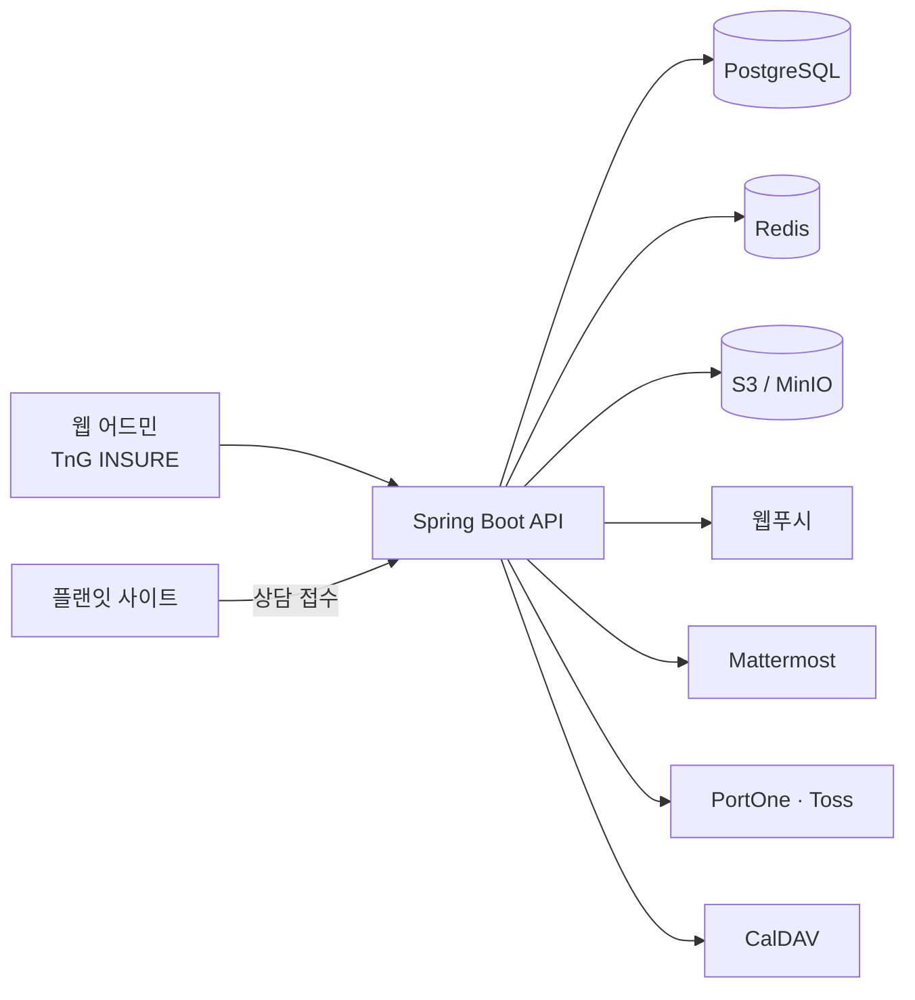
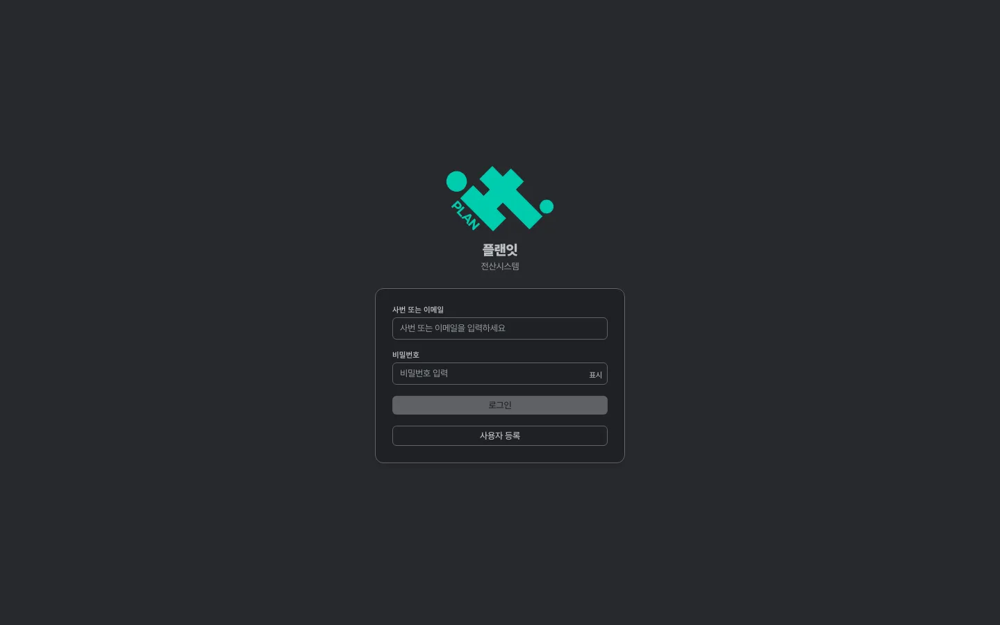

# TnG INSURE — 사내 보험 전산

[← 포트폴리오 홈](../README.md)

> 회사 업무 저장소는 비공개입니다. 코드 대신 구조와 결정만 설명합니다.

## 개요

보험·휴대폰·인터넷·렌탈·여행 5개 업종의 고객과 상담을 한곳에서 관리하는 사내 전산입니다.
Spring Boot 백엔드가 전산 API 와 대외 사이트 플랜잇의 API 를 함께 제공하고, React 웹 어드민 「TnG INSURE」가 사내 화면을 맡습니다.
최근에는 견적 일정표 저장·공개 API, 모두투어 견적 사진 매핑, 여행 계약서 PDF 읽기와 계약 보고, 플랜잇 고객 소셜 로그인 API 를 더했습니다.

| 저장소 | 시작 | 내용 | 커밋(담당/전체) | 테스트 |
|---|---|---|---|---|
| Insurance_backend | 2026-08-05 | Spring Boot API 서버 | 829 / 1,064 (78%) | JUnit 5,459건 |
| Insurance_frontend | 2026-08-10 | 웹 어드민 「TnG INSURE」 | 802 / 941 (85%) | 1,973건 |
| Insurance_infra | — | Terraform 설계 초안 18개 파일 | — | — |

- 백엔드: Java 약 28만 줄(이 중 절반이 테스트), Flyway 마이그레이션 101개
- 프런트엔드: TypeScript 약 8.5만 줄

<!-- 2026-11-06 집계. 커밋 = `git shortlog -sne --all` 본인/전체, 테스트 = origin/dev 실행 결과(백엔드 `./gradlew test` 결과 XML 의 tests 합, 프런트 `npm test` 의 tests), 줄 수·마이그레이션 = origin/dev 소스 기준. 10/27 의 JUnit 4,509건·프런트 1,844건은 소스의 @Test · test( 수였음. -->

## 역할

- 도메인 설계와 API 구현, DB 스키마·마이그레이션 관리
- 웹 어드민 화면 구현, 피그마 시안 적용, 모바일·다크모드 대응
- CI/CD 구성과 dev·운영 배포, dev → 운영 승격 관리
- 플랜잇 사이트 접수를 전산 업무로 잇는 동기화와 알림, 플랜잇 견적·회원 API
- 반복되는 엑셀 업무 도구화(렌탈 수수료표 월간 갱신, 휴대폰 단가표 변환)

## 스택

| 구분 | 기술 |
|---|---|
| 백엔드 | Java 17, Spring Boot 3.5, PostgreSQL, Redis, Flyway, JWT, PDFBox |
| 프런트엔드 | React 19, vinext(Vite 8 SSR), Tailwind CSS 4, Tiptap, TypeScript |
| 저장소·연동 | S3/MinIO, 웹푸시, CalDAV, PortOne·Toss 결제, Mattermost(자체 운영), 모두투어 API, 네이버·카카오 로그인 |
| 배포 | GitHub Actions, Docker Compose + Caddy(dev EC2), ECR → ECS(운영) |
| 인프라 설계 | Terraform(VPC·ALB·RDS 초안) |
| 업무 도구 | Python 3.12, openpyxl |

## 구조



배포 흐름

```text
ci.yml (테스트)
        ├─▶ deploy-dev.yml  ─▶ EC2 · docker compose + Caddy          (dev)
        └─▶ deploy-prod.yml ─▶ ECR 이미지 ─▶ ECS 배포 ─▶ 헬스체크   (운영)
```

## 핵심 기능

### 백엔드 도메인

| 영역 | 내용 |
|---|---|
| 인증·조직 | JWT 인증, 조직, 역할별 권한 |
| 고객·상담 | 고객, 상담 케이스(보험·휴대폰·인터넷·렌탈·여행 5개 업종) |
| 계약·정산 | 보험계약 원장, 매출, 수수료, 대시보드 |
| 소통 | 공지, 알림, 녹취, 메신저 |
| 일정·근태 | 캘린더(CalDAV), 근태 |
| 결제·포인트 | 포인트, PortOne·Toss 결제 |
| 단가 | 휴대폰·렌탈 단가표, 렌탈 수수료표 직원별 마진률(원 수수료를 저장해 두고 조회하는 직원의 마진률로 다시 계산) |
| 사이트 연동 | 사이트 접수 → 고객·케이스 자동 생성, 유입 매체 분류, 미배정 알림, 모두투어 그룹번호 만료 대응(동기화가 번호를 미리 옮기고 사라진 번호는 상품코드로 되찾음) |
| 계약 보고 | 실적 › 계약 보고(2026-11-04): 직원이 올린 계약을 승인 없이 기록하고 상담건 계약 칸을 같은 트랜잭션에서 채움, 조회 범위는 보고자 기준(전사·부서·본인) |
| 여행 계약서 | 서명된 후불 약정서 PDF 의 텍스트 층에서 칸을 읽어 상담건별로 기록(2026-11-04). 스캔본은 실패, 핵심 칸이 빠지면 검토 필요로 표시하고 사람이 고쳐 확정 |
| 플랜잇 견적 | 모두투어 견적 상세 조회, 견적번호 자동 발번, 고객 일정표 스냅샷 저장·공개 조회(2026-11-05), 견적 상세에 상품 상세·일정·호텔 세 API 의 사진 주소 매핑(2026-11-06) |
| 플랜잇 회원 | 고객 네이버·카카오 소셜 로그인 API(2026-10-28). 직원 토큰과 서명 키·쿠키·보안 체인을 분리, 탈퇴 시 개인정보 즉시 삭제 |

### 웹 어드민 화면

- RSA 암호화·2단계 로그인
- 고객·상담 케이스 관리
- 보험계약 엑셀 임포트
- 매출·수수료 화면
- 렌탈 수수료표 직원별 마진률 관리
- 계약 보고 화면(카테고리 탭·조회·엑셀). 상담건에서 「계약 완료」를 켜면 그 상담건으로 보고 양식을 엽니다.
- 여행 계약서 패널(PDF 업로드 → 읽은 칸 확인·확정)
- 역할별 권한
- 캘린더, 근태
- 모바일 대응, 다크모드
- 피그마 시안 적용

### 업무 도구

- **렌탈 수수료표 월간 갱신 도구 체인**(Python 스크립트 6개): 렌탈사 원본 엑셀은 읽기만 하고 ① 수수료 가공본 ② 전산 업로드 양식(15열) ③ 전월 대비 변경분을 차례로 만듭니다. 처음 보는 시트·머리글이 나오면 종료 코드로 멈춰 양식 변화를 잡고, 렌탈사 정책 파일과 프로모션 PPT 도 변환합니다. 11월분을 이 체인으로 만들어 운영에 반영했습니다.
- **휴대폰 단가표 변환 도구 키트**(2026-10-27): 통신사 단가표 이미지를 엑셀로 옮기는 도구를 키트로 묶어 팀원에게 인수인계했습니다.

## 기술적으로 고민한 점

### 1. 제외 집합으로 관리하는 dev → 운영 승격
dev 에는 기능이 계속 쌓이지만, 모든 기능이 같은 시점에 운영에 올라가지는 않습니다.
승격할 때마다 `promote/<날짜>` 브랜치를 만들고, 아직 운영에 올리지 않을 기능의 파일을 **제외 집합**(백엔드 146개·프런트엔드 54개 파일)으로 묶어 빼고 올립니다.
운영에 올릴 범위를 승격 시점에 고를 수 있고, 이 방식으로 19차 승격(2026-11-06)까지 진행했습니다.

### 2. 사이트 접수를 전산 업무로 바꾸는 동기화
플랜잇 사이트의 접수(`site_inquiry`)는 그대로 두면 상담 업무로 이어지지 않습니다.
접수가 들어오면 고객과 상담 케이스를 자동으로 만들고, UTM·referrer 로 유입 매체를 분류합니다.
담당자가 정해지지 않은 접수는 인앱 알림·웹푸시·Mattermost 로 알려 놓치지 않게 했습니다.

### 3. 환경별로 다른 배포 경로
dev 는 EC2 한 대에서 docker compose 와 Caddy 로 빠르게 반영하고, 운영은 ECR 이미지를 ECS 에 배포한 뒤 헬스체크로 확인합니다.
두 경로 모두 `ci.yml` 테스트를 통과한 코드만 받습니다. Terraform 저장소는 VPC·ALB·RDS 설계 초안 단계이며, 운영 배포는 GitHub Actions 파이프라인이 맡습니다.

### 4. 테스트 비중
백엔드 Java 코드의 절반이 테스트이고 JUnit 5,459건, 프런트엔드 테스트 1,973건이 있습니다.
업종 5개와 역할별 권한이 얽힌 도메인이라 기능을 더할 때 기존 동작이 깨지지 않았는지 테스트로 먼저 확인합니다.

### 5. 정적 사이트를 위한 공개 조회 API
플랜잇 사이트는 정적 파일이라, 어드민에서 새로 발급한 견적번호의 일정은 서버에서 읽어야 합니다.
저장 API 는 일정 JSON 을 해석하지 않고 번호 형식, 본문 크기(64KB), JSON 객체인지만 확인한 뒤 정해 둔 최상위 키만 남겨 번호별로 덮어씁니다. 공개 조회는 저장한 스냅샷을 캐시 없이 그대로 돌려주고, 저장되지 않았거나 형식이 틀린 번호는 오류 코드가 있는 404 로 답합니다.
저장 API 는 404·405 를 내지 않게 했습니다. 프런트가 이 둘을 「API 가 아직 배포되지 않음」으로 읽기 때문입니다. 본문은 스트림으로 상한 + 1바이트까지만 읽고, 권한 판정은 본문을 읽기 전에 합니다.

### 6. 외부 API 응답에서 사진만 골라 싣기
모두투어 견적 상세에 쓰는 세 응답(상품 상세·일정·호텔)에는 사진 주소가 이미 들어 있었지만 읽지 않고 있었습니다.
대표 사진·일차별 관광지·호텔 사진을 각각 상한을 두고 매핑하되, 일정에서 빠지는 항목(선택관광 안내·식사·숙박·숨김)의 사진은 빼서 포함되지 않은 일정이 포함된 것처럼 보이지 않게 했습니다. 구글 장소·외부 호텔 DB 사진은 라이선스 때문에 싣지 않습니다.
세 칸은 따로 감싸 사진 매핑이 깨져도 기존 칸은 그대로 나갑니다. 테스트 픽스처는 실제 응답에서 매퍼가 읽는 키만 남겨(화이트리스트) 직원 식별 칸 같은 값이 저장소에 들어가지 않게 했습니다.

### 7. 렌탈 변경분에서 「키만 바뀐 것」 가려내기
렌탈사 원본 엑셀은 달마다 시트 이름·열 순서·상품명 꼬리표가 바뀝니다. 업로드 양식 변환은 열 문자를 박지 않고 머리글 문구로 열을 찾고, 처음 보는 시트나 머리글이 나오면 종료 코드로 멈춰 사람이 규칙을 정하게 했습니다.
전월 대비 변경분은 상품 키로 신규·삭제·수수료 변경을 나누고 「이전 − 삭제 + 신규 = 새」 같은 등식을 검증합니다. 상품명 꼬리표만 바뀌어도 삭제 + 신규로 잡히므로, 같은 렌탈사의 삭제·신규 행을 모델명 + 의무개월로 짝지어 「키 글자만 바뀐 것」과 「진짜 빠진 것」을 따로 보여 줍니다.

## 화면



사내 시스템이라 공개 가능한 로그인 화면만 싣습니다.
