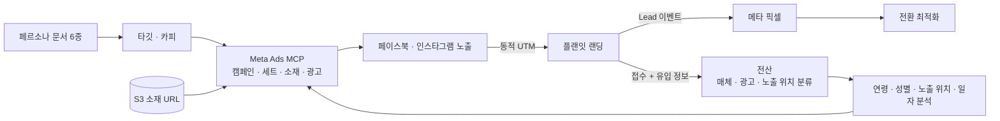
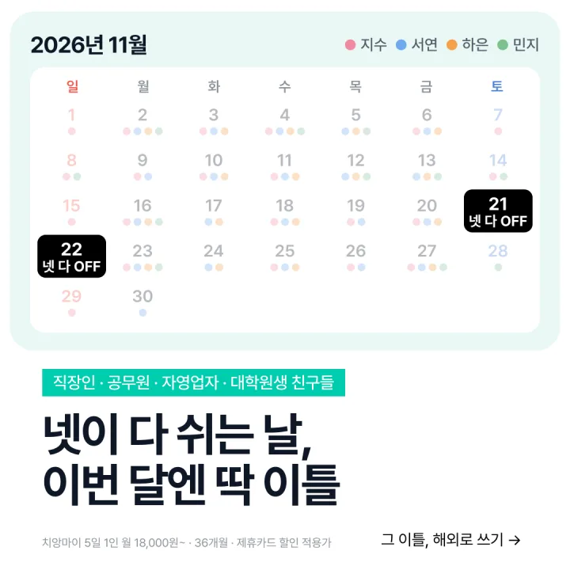

# 메타 광고 운영 — 코드로 만들고 전산으로 추적하는 광고

[← 포트폴리오 홈](../README.md)

> 금액·성과 수치와 계정·픽셀 식별자는 싣지 않습니다. 구조와 운영 방식만 설명합니다.

## 개요

플랜잇 사이트로 상담 접수를 모으기 위한 메타(페이스북·인스타그램) 광고 운영입니다.
**메타 공식 Ads MCP** 로 캠페인·광고 세트·소재·광고를 코드로 생성·분석·조정합니다.
광고 클릭에서 사이트 접수, 전산의 고객·상담 케이스까지 한 줄로 이어지도록 계측을 설계했습니다.
여행 목적별 캠페인(신혼·우정·가족)을 각 랜딩(LP-04·LP-06·LP-07)에 이어 운영합니다.

## 역할

- 캠페인 구조 설계: 전환 목표, 광고 세트 분리 기준, 노출 위치·연령 설정
- 소재·카피: 페르소나 문서 기반 타깃과 문구, 표현 규칙 점검, 소재 등록
- 계측: 메타 픽셀 Lead 이벤트(사이트 코드), 동적 UTM, 전산 유입 매체 분류(백엔드 코드)
- 분석·조정: 노출 위치·연령별 결과를 보고 세트 구조와 타깃 수정, 연령·성별·노출 위치·일자별 성과 분석 리포트 작성

## 도구

| 구분 | 내용 |
|---|---|
| 광고 운영 | 메타 공식 Ads MCP(캠페인·광고 세트·소재·광고 생성과 인사이트 조회), Claude Code |
| 전환 신호 | 메타 픽셀 Lead 이벤트(접수 성공 시 1회, eventID 중복 제거) |
| 유입 추적 | 동적 UTM, 전산 유입 매체 분류(ig/fb · 광고 · 노출 위치) |
| 소재 | 정사각(1080)·세로(1080x1920) 두 규격, S3 에 올린 뒤 URL 로 등록, Advantage+ 크리에이티브 자동 음악(`music_generation`) |
| 분석 | 인사이트를 연령·성별·노출 위치·일자별로 나눠 조회, 전산 접수(UTM)와 대조 |
| 기준 문서 | 페르소나 문서 6종, 표현 금지 규칙 |

## 구조

## 핵심 운영 방식

- **코드로 광고 생성**: 캠페인 → 광고 세트 → 소재 → 광고 순서로 MCP 도구를 호출해 만들고, 같은 경로로 인사이트를 조회해 조정합니다.
- **Lead 전환 최적화**: 플랜잇 픽셀의 Lead 이벤트를 최적화 목표로 씁니다. 이벤트는 사이트에서 상담 접수가 성공했을 때만 한 번 발생합니다.
- **페르소나 기반 타깃·카피**: 여행 목적별 페르소나 문서 6종을 기준으로 타깃과 문구를 정합니다.
- **표현 규칙**: 「무이자」「0원」「최저가」는 쓰지 않습니다. 조건이 붙는 가격은 「1인」「개월」을 함께 적습니다.
- **동적 UTM**: 새 광고에는 `utm_source={{site_source_name}}` 를 비롯해 노출 위치(`{{placement}}`)·광고 이름(`{{ad.name}}`) 같은 동적 값을 반드시 붙입니다.
- **세트 구조 조정**: 노출 위치·연령 분석 결과로 Audience Network 를 제외하고, 연령을 고정하고, 피드와 릴스를 별도 세트로 나눴습니다.
- **여행 목적별 캠페인**: 신혼여행(LP-04)에 이어 우정여행(LP-06)·가족여행(LP-07) 캠페인을 더했습니다. 캠페인마다 해당 페르소나의 연령대로 타깃을 고정하고 그 랜딩으로 보냅니다.
- **노출 위치별 광고 세트**: 캠페인마다 피드(정사각) 세트와 릴스·스토리(세로) 세트를 따로 두고, 규격에 맞는 소재를 각각 붙입니다.
- **자동 음악**: 새 소재는 Advantage+ 크리에이티브의 자동 음악(`music_generation`)을 켜서 등록합니다.
- **성과 분석 리포트**: 픽셀 Lead 기준 결과를 연령·성별·노출 위치·일자별로 나눠 보고, 전산에 들어온 접수와 맞춰 본 뒤 다음 타깃·세트 구조를 정합니다.

## 기술적으로 고민한 점

### 1. 광고와 실제 접수 건을 잇는 추적
광고 관리자의 전환 수만으로는 어떤 접수가 어느 광고에서 왔는지 전산에서 알 수 없습니다.
그래서 동적 UTM 을 광고 URL 에 붙이고, 사이트가 UTM·referrer 를 접수와 함께 전산으로 보내도록 했습니다.
전산은 이 값으로 유입 매체(ig/fb)를 분류하고 광고 이름·노출 위치까지 기록합니다.

### 2. 학습 신호로 쓸 수 있는 Lead 이벤트
최적화 목표가 Lead 이므로 이벤트가 빠지거나 두 번 잡히면 학습이 흔들립니다.
Lead 는 서버가 접수 성공을 응답한 뒤에만 한 번 보내고, eventID 를 붙여 같은 접수가 중복 집계되지 않게 했습니다.

### 3. 노출 위치·연령 분석에 따른 세트 재구성
노출 위치·연령별 결과를 나눠 본 뒤 Audience Network 제외, 연령 고정, 피드·릴스 세트 분리로 구조를 바꿨습니다.
소재는 피드용 정사각(1080)과 릴스용 세로(1080x1920) 두 규격으로 준비합니다.

### 4. 광고 문구의 표현 규칙
후불 여행은 월 납부 금액이 눈에 띄는 상품이라 오해를 부르는 표현이 생기기 쉽습니다.
「무이자」「0원」「최저가」는 금지하고, 조건부 가격에는 「1인」「개월」과 적용 조건을 함께 적는 규칙을 두고 카피를 쓸 때마다 점검합니다.

### 5. 노출 위치별 소재를 세트 분리로 대신하기
한 광고에 노출 위치마다 다른 소재를 붙이는 기능은 지금 쓰는 MCP 로는 열려 있지 않습니다.
그래서 같은 타깃의 광고 세트를 피드용과 릴스·스토리용으로 나누고, 피드 세트에는 정사각 소재, 릴스·스토리 세트에는 세로 소재를 붙였습니다.

### 6. 고칠 수 없는 크리에이티브
자동 음악 같은 크리에이티브 기능은 만든 뒤에 바꿀 수 없습니다.
기능을 바꿀 때는 크리에이티브와 광고를 새로 만들어 켜고, 이전 광고는 일시정지해 둔 뒤 정리합니다.

### 7. 성과를 나눠 보는 기준
결과는 연령·성별·노출 위치·일자 네 축으로 나눠 봅니다. 같은 캠페인 안에서도 연령·성별·지면에 따라 반응이 달라질 수 있어서, 합계만 보고는 무엇을 바꿀지 정하기 어렵습니다.
결과가 기대와 다르면 먼저 계측 경로(같은 접수 폼·같은 Lead 이벤트)가 다른 랜딩과 같은지 확인해 기술 결함을 배제하고, 그다음 소재·타깃을 봅니다.

## 화면 — 우정여행 소재 예시

| 대화형 소재 | 달력형 소재 |
|---|---|
|  |  |

두 소재 모두 가격 옆에 「1인」「36개월」「제휴카드 할인 적용가」 조건을 함께 적었습니다.
