# 플랜잇 — 후불 여행·생활 상담 사이트

[← 포트폴리오 홈](../README.md)

> 회사 업무 저장소는 비공개입니다. 코드 대신 구조와 결정만 설명합니다.

## 개요

후불 여행·보험·휴대폰·렌탈 상담을 받는 대외 사이트입니다. 운영 주소는 [플랜잇.com](https://플랜잇.com) 입니다.

| 항목 | 내용 |
|---|---|
| 기간 | 2026-08-20 ~ 운영 중 |
| 커밋 | 366 / 607 (60%) |
| 테스트 | vitest 1,686건 |
| 배포 | 운영 S3 + CloudFront, dev EC2 |

<!-- 2026-10-27 집계. 커밋 = `git shortlog -sne --all` 본인/전체, 테스트 = origin/dev 의 *.test.ts(x) 안 it( 수. 10/23 초안의 932건은 오래된 로컬 체크아웃 기준이었음. -->

## 역할

- 페이지 설계·구현: 홈, 여행 목록·상세, 여행 랜딩 시리즈, 링크 허브·월 납부금 플로우, 휴대폰·렌탈·인터넷·보험 페이지
- 피그마 시안 코드화: 웹 1440·모바일 390 두 벌, 스크롤 모션 포함
- 상담 접수 폼과 전산 연동(접수 API 는 전산 백엔드가 제공)
- 계측: 메타 픽셀, GA4, Clarity, 네이버 분석, 유입 경로 수집
- 배포·인프라: GitHub Actions(OIDC) → S3 + CloudFront, CloudFormation

## 스택

| 구분 | 기술 |
|---|---|
| 프레임워크 | Next.js 15 정적 내보내기(`output: 'export'`), React 19, TypeScript |
| 그래픽 | three.js |
| 테스트·검증 | vitest, 헤드리스 Chrome 시안 대비 픽셀 검증 |
| 배포 | GitHub Actions(OIDC) → S3 + CloudFront(운영), EC2(dev) |
| 인프라 | CloudFormation |
| 연동 | 카카오 JS SDK, 메타 픽셀, GA4, Microsoft Clarity, 네이버 분석 |

## 구조

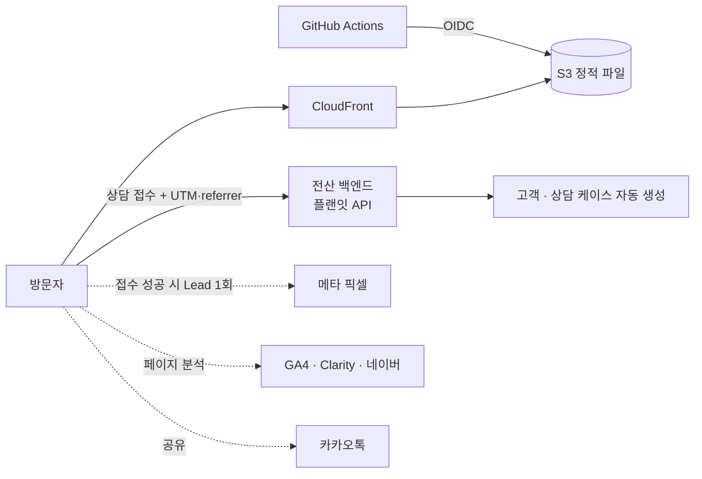

## 핵심 기능

- **홈 랜딩**과 **여행 목록·상세**
- **여행 랜딩 시리즈**: 피그마 시안을 웹 1440·모바일 390 두 벌로 1:1 코드화하고 스크롤 모션을 붙였습니다.
  - LP-01 원페이지 상담, LP-02 후불여행, LP-03 동남아 월 가격, LP-04 신혼여행, LP-06 우정여행, LP-07 가족여행
  - 카테고리별 정적 경로 `/travel/lp/<slug>/` 10개
  - LP-07 가족여행: 가족에게 보내는 공유 카드(카카오톡 공유)와 인원 계산기(3·4·5인 + 직접 입력, 1인 월 금액 × 인원)
- **링크 허브(LP-08)**: 인스타그램 캐러셀에서 들어오는 [`/link/`](https://플랜잇.com/link/). 버튼마다 UTM 을 붙여 어느 버튼으로 들어온 유입인지 전산에서 구분합니다.
- **월 납부금 플로우(LP-08)**: [`/link/monthly/`](https://플랜잇.com/link/monthly/) 01 여행지 → 02 인원·시기 → 03 결과·카카오톡 공유 → 04 상담 신청. 상담 신청은 여행 랜딩 폼과 같은 규칙·접수 API 를 쓰고, 앞 단계에서 고른 값을 미리 채웁니다.
- **견적 일정표 랜딩**: 견적번호마다 일정표 페이지를 공용 화면 틀 하나와 견적별 데이터 모듈로 찍어 냅니다(검색 노출 제외).
- **상담 접수 폼**: 생년월일·납부 방식 등 전 항목 필수, 개인정보 동의 문구는 버전으로 관리, 입력 칸 초점 표시는 칸 테두리 한 겹으로 통일
- **휴대폰 비교·견적**, **렌탈·인터넷·보험** 페이지
- **테마 페이지 영상 히어로**: 여러 테마 페이지가 쓰는 공용 컴포넌트
- **카카오톡 공유**: 투표 카드를 피드 메시지로 보내고, 실패하면 `navigator.share` → 클립보드 순서로 대체
- **계측**: 메타 픽셀 Lead, GA4·Clarity·네이버 분석, UTM·referrer 수집 → 전산 매체 분류

## 기술적으로 고민한 점

### 1. 정적 내보내기와 랜딩 페이지의 공존
서버 없이 S3 + CloudFront 로 서비스하려고 `output: 'export'` 를 썼습니다. 요청 시점 렌더링이 없으므로 랜딩 경로는 카테고리별 정적 경로 10개(`/travel/lp/<slug>/`)로 빌드 때 미리 만듭니다.
상담 접수처럼 서버가 필요한 동작은 전산 백엔드의 플랜잇 API 로 넘겨, 사이트 자체는 정적 파일로만 유지합니다.

### 2. 메타 픽셀 Lead 중복 제거
Lead 이벤트는 광고 최적화의 학습 신호입니다. 버튼을 누른 시점이 아니라 서버가 접수 성공을 응답한 뒤에만 한 번 보내고, eventID 를 함께 보내 같은 접수가 두 번 집계되지 않게 했습니다.

### 3. 카카오 SDK 초기화 순서와 폴백
카카오 JS SDK 는 외부 스크립트라 로드가 끝나기 전에 공유 버튼이 눌릴 수 있습니다. SDK 로드 → 초기화 → 공유 호출 순서를 지키고, SDK 를 쓸 수 없는 환경에서는 `navigator.share`, 그것도 없으면 클립보드 복사로 이어지게 했습니다.

### 4. 빌드 변수로 분석 ID 주입, dev 제외
픽셀·GA4·Clarity·네이버 분석 ID 는 코드에 적지 않고 빌드 변수로 주입합니다. dev 빌드에서는 분석 스크립트를 넣지 않는 규칙을 둬 테스트 트래픽이 운영 데이터에 섞이지 않게 했습니다.

### 5. 시안과 픽셀 단위로 맞추는 검증
피그마 MCP 로 시안의 수치를 읽어 옮긴 뒤, 헤드리스 Chrome 으로 1440·390 화면을 캡처해 같은 폭의 시안과 구간별로 비교합니다. 어긋난 구간을 찾아 고치고 다시 캡처하는 과정을 반복합니다.

### 6. 공유 링크로 그대로 다시 여는 계산 결과
월 납부금 플로우는 한 페이지 안에서 01~04 단계를 바꿔 그리지만, 지금 단계와 고른 값(여행지·인원·시기)을 주소의 쿼리에 함께 담습니다.
그래서 03 결과 화면을 카카오톡으로 보내면 받은 사람도 같은 결과 화면을 바로 엽니다. 여행지별 1인 월 금액은 여행 목록과 같은 상품 데이터·계산을 써서 페이지마다 숫자가 어긋나지 않게 했습니다.

## 화면

> 헤드리스 Chrome 으로 캡처했습니다(데스크톱 1440, 모바일 390). 전체 페이지 캡처는 하단 회사 정보 영역을 잘라 냈습니다.

### 여행 랜딩 — 첫 화면

| LP-06 우정여행 | LP-04 신혼여행 |
|---|---|
|  | 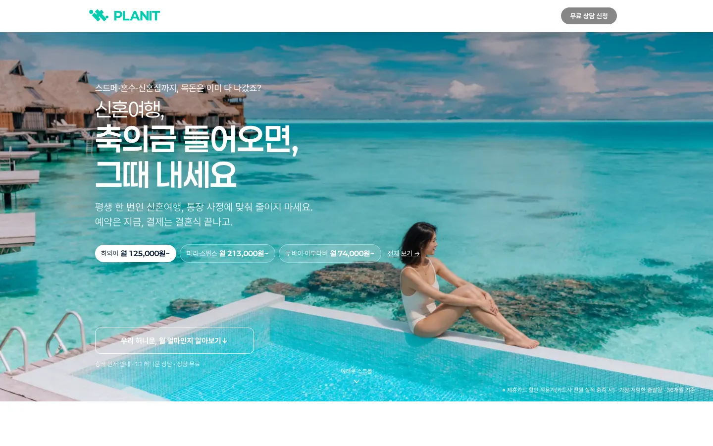 |
| **LP-03 동남아 월 가격** | **우정여행 테마 페이지(영상 히어로)** |
| 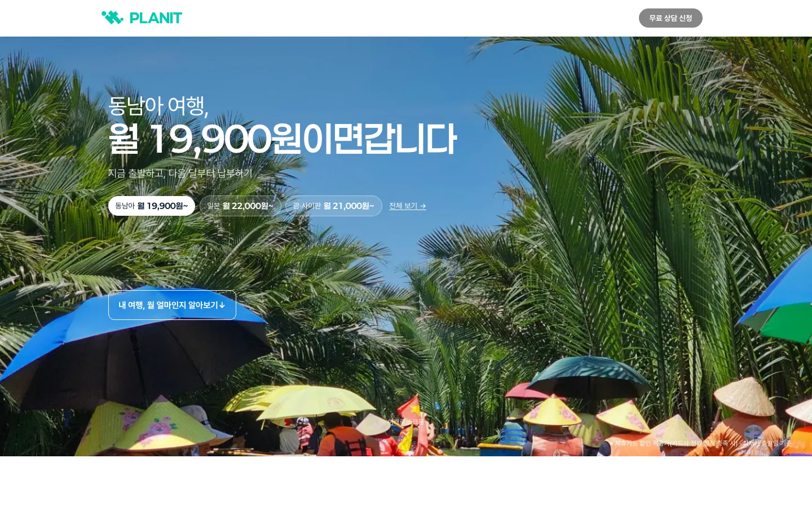 | 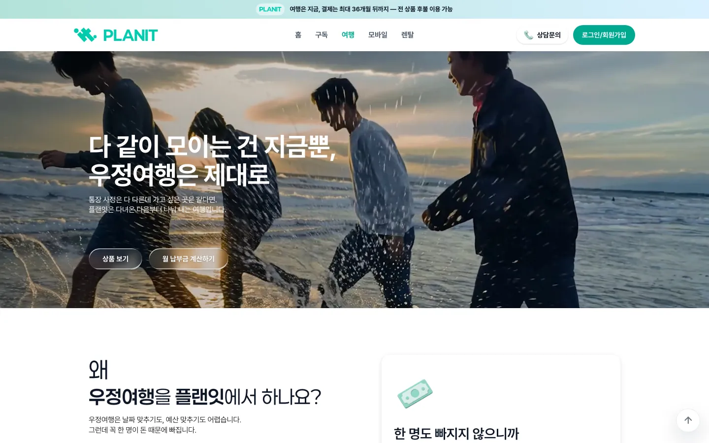 |

### LP-06 우정여행 — 웹·모바일 두 벌

같은 시안을 웹 1440·모바일 390 두 벌로 옮겼습니다. 전체 페이지는 펼쳐서 볼 수 있습니다.

  
  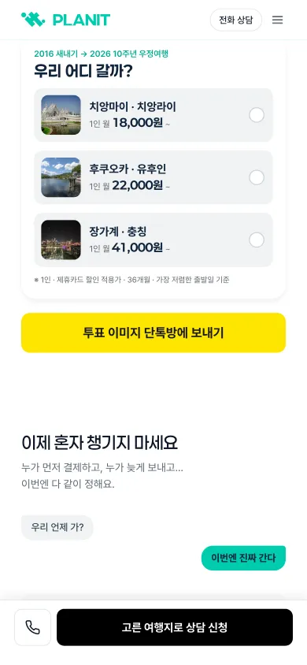

왼쪽은 모바일 첫 화면, 오른쪽은 단톡방 투표 카드와 카카오톡 공유 버튼입니다.

LP-06 데스크톱 전체 페이지

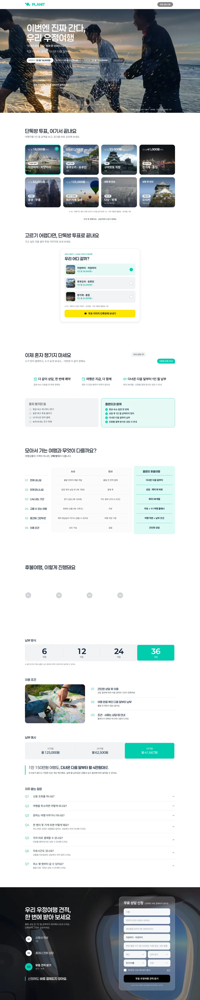

LP-06 모바일 전체 페이지

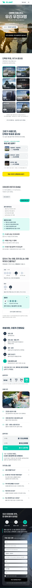

LP-04 신혼여행 데스크톱 전체 페이지

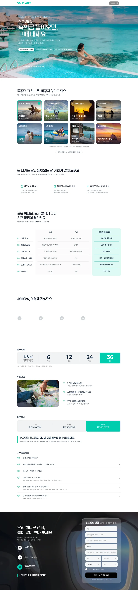

### LP-07 가족여행 — 웹 첫 화면·모바일 전체

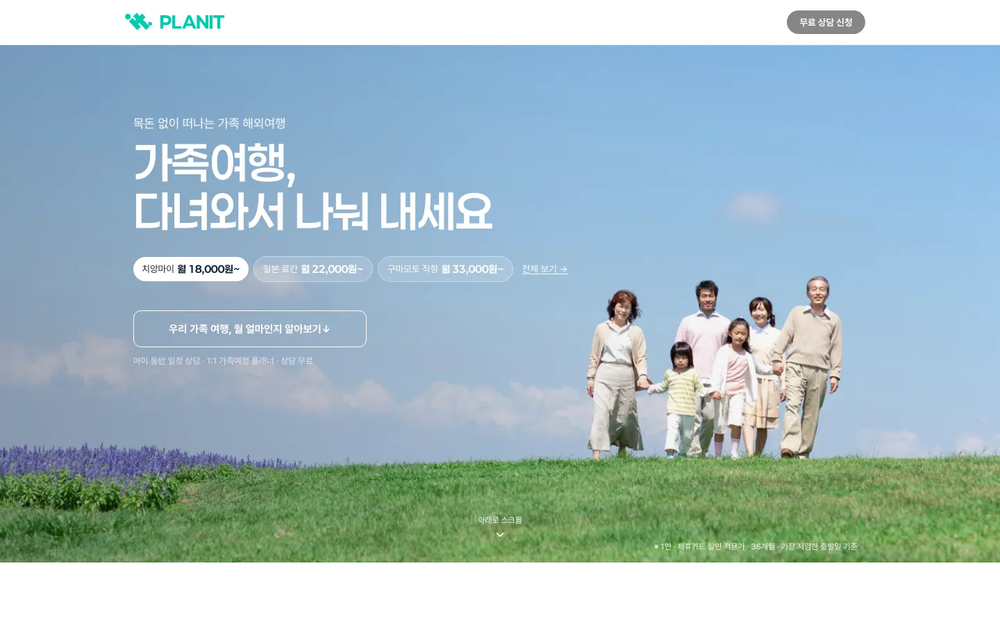

LP-07 모바일 전체 페이지

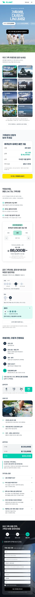

모바일 전체 페이지 중간에 가족 공유 카드(노란 카카오톡 공유 버튼)와 인원 계산기가 있습니다.

### LP-08 링크 허브 · 월 납부금 플로우 — 모바일 390

  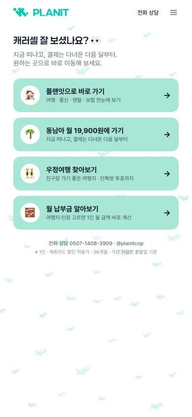
  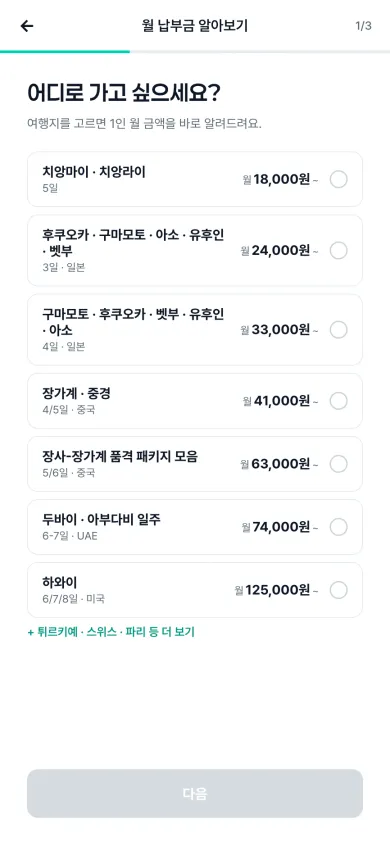

왼쪽은 인스타그램 캐러셀에서 들어오는 링크 허브, 오른쪽은 월 납부금 플로우의 01 여행지 단계입니다.

### 그 밖의 페이지

| 홈 | 여행 목록 |
|---|---|
| 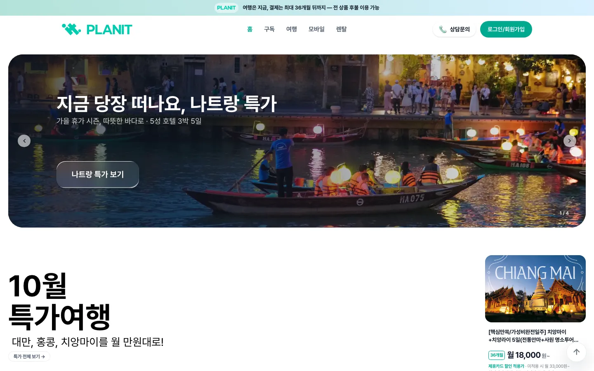 | 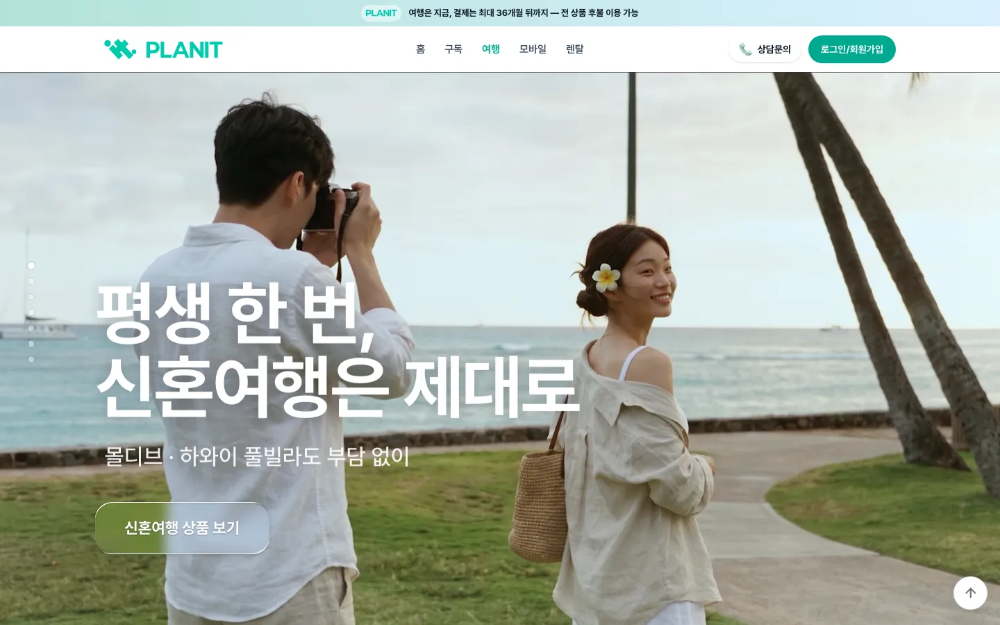 |
| **휴대폰 페이지** | |
| 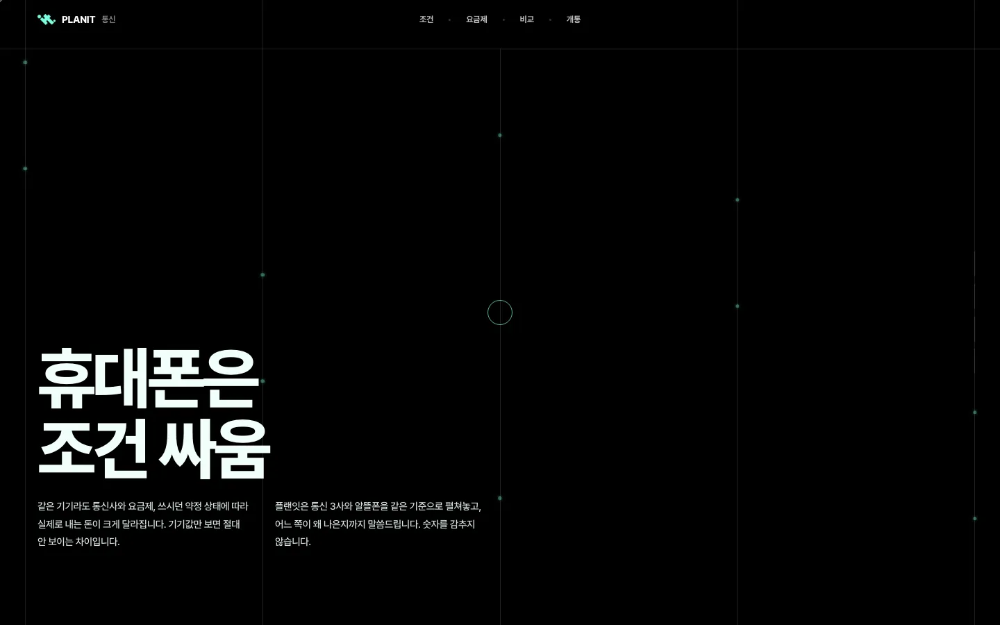 | |
